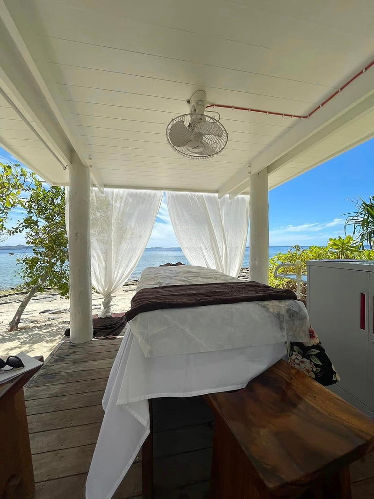

---

title: "[斐濟自由行]： 2022.10.12 Day 3: Malamala Island"
date: 2024-01-30
slug: "2024-01-30-fiji-day-3"
cover:
  image: "images/medium-0*UYQREHkp_4KGojw-.jpg"
  alt: "斐濟海邊度假村風景"
  credit:
    photographer: "jcob nasyr"
    photographer_url: "https://unsplash.com/@j_cobnasyr1"
    photo_url: "https://unsplash.com"
images: ['images/medium-0*UYQREHkp_4KGojw-.jpg', 'images/medium-0*dT_WyPnWXajYGYcL.jpg', 'images/medium-0*R9AbkCk0zQIkb9-o.jpg', 'images/medium-0*p9yMD2FNOryFwREY.jpg', 'images/medium-0*5aNAFP6zOqe13T5_.jpg', 'images/medium-0*tx1vHrgAoRwihmAn.jpg', 'images/medium-0*iXqoP6t0sPIp1q7b.jpg', 'images/medium-0*5RrmqHw5bxvmzDi8.jpg', 'images/medium-0*B8sqPydAQ1MWoyjD.jpg', 'images/medium-0*h57D05cqAs4ZsQr-.jpg']
categories: ["旅行紀錄"]
tags: ["旅遊", "斐濟"]
episodeseries: ["斐濟旅記"]
---

* * *

我突然發現斐濟人講話喜歡講兩次XD 例如我的旅館叫 Tokatoka，這個島叫 Malamala Island～哈哈

準備登船前往 Malamala~






*登船出海*

途中必須再度炫耀一下我的美甲！Malamala 就是這麼一個很圓的小島






*美甲與排隊登島的遊客*

我超級推薦這個小島的！因為這裡水超清澈無雜質，站在 jetty 上就可以看到底下的各種魚！

島上還有無邊際游泳池，跟各種免費的水上活動裝備租借，包含浮潛、獨木舟跟 SUP (stand up paddling)！我除了喝雞尾酒、按摩、玩水之外就是在各個角落睡午覺，太爽了！






食物無敵好吃、調酒無敵好喝！






*這兩杯調酒的好喝程度都跟 Tokatoka 旅館不是同一個等級的*

按摩區在海邊，可以一邊聽海浪聲一邊按摩。

服務人員的態度也超級無敵好，我甚至看到他們幫忙遊客夫婦帶小孩，讓遊客可以毫無牽掛地進行各種行程，我強力推薦大家一定要來！
